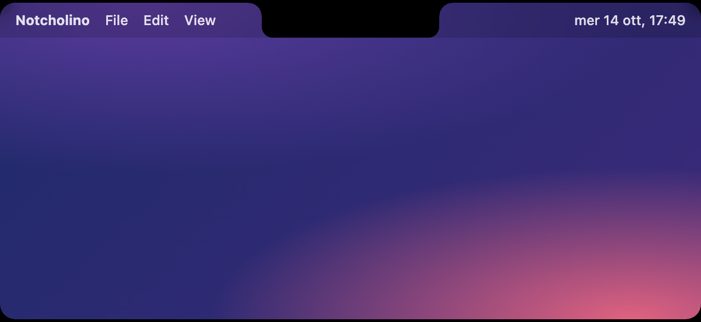
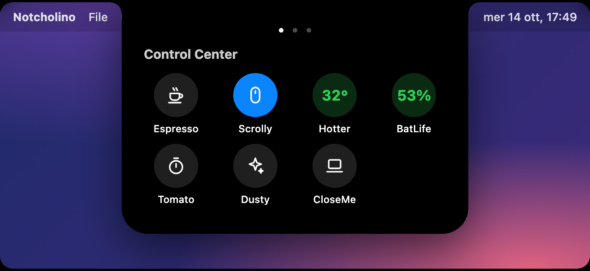

<p align="center">
  
</p>

<h1 align="center">Notcholino</h1>

<p align="center">
  <b>A living Notch for macOS.</b><br>
  Turn the notch of your MacBook into a dynamic hub for music, calendar, reminders and system feedback.<br>
  Free, open source, and made with SwiftUI.
</p>

<p align="center">
  <a href="https://github.com/Peppe37/Notcholino/releases/latest"></a>
  <a href="https://github.com/Peppe37/Notcholino/releases"></a>
  <a href="https://github.com/Peppe37/Notcholino/stargazers"></a>
  
  
  <a href="LICENSE"></a>
  <a href="https://github.com/Peppe37/Notcholino/commits/main"></a>
  <a href="https://github.com/Peppe37/Notcholino/issues"></a>
  <a href="https://github.com/sponsors/Peppe37"></a>
</p>

<p align="center">
  <a href="https://peppe37.github.io/Notcholino/">Website</a> ·
  <a href="https://github.com/Peppe37/Notcholino/releases/latest">Download</a> ·
  <a href="#faq">FAQ</a> ·
  <a href="CHANGELOG.md">Changelog</a> ·
  <a href="https://github.com/Peppe37/Notcholino/discussions">Discussions</a> ·
  <a href="https://github.com/Peppe37/Notcholino/issues/new/choose">Report an issue</a> ·
  <a href="#support-the-project">Sponsor ❤️</a>
</p>

---

> **Status: alpha.** Notcholino is in early development. Expect rough edges and breaking changes between versions. Feedback is very welcome.

**Contents:** [What is it?](#what-is-it) · [Features](#features) · [Install](#install) · [Usage](#usage) · [Plugins](#plugins) · [FAQ](#faq) · [Privacy](#privacy) · [Performance](#performance) · [Roadmap](#roadmap) · [Support and contributing](#support-and-contributing) · [Building from source](#building-from-source) · [Releases](#releases-and-versioning) · [License](#license)

## What is it?

Notcholino is a free, open-source and non-commercial app that extends the hardware notch of your MacBook with a fluid overlay. It stays out of the way as a small pill, and expands when you hover it to show what matters: what is playing, what is on your calendar, the reminders due today, and the volume and brightness you are changing.

## Features

- **Dynamic notch**: a native overlay that blends with the hardware notch and expands when you move the pointer to it. Works on the main display or on all displays.
- **Now Playing**: control Spotify and Apple Music from the notch. Album art, scrubbable progress bar, seek, shuffle and repeat, an animated waveform, and colors extracted from the artwork. Click the song to bring the player to the front. A paused song stays on screen, and the controls always go to the player you see when both are open.
- **Any app**: besides Spotify and Music, Notcholino shows whatever macOS reports as playing, with play/pause, next, previous and seek: YouTube, Netflix or Prime Video in a browser, Amazon Music, Podcasts and more. Shuffle, repeat and like are only for Spotify and Music. Whether a site or app appears depends on it reporting to macOS "Now Playing", the same list you see in Control Center.
- **Compact music mode**: while music plays, the collapsed notch shows the album art and a live waveform.
- **Spotify Like**: connect your account once (OAuth with PKCE) to like the current song from the notch.
- **Calendar and Reminders**: today's date, the next event with its calendar color and location, a month view, and the reminders due today (click the circle to complete one). Pick which calendars to show, and click an event to open it in Calendar.
- **Permission buttons**: wherever something needs a permission (Calendar, Reminders, controlling Spotify or Music, Accessibility, your Spotify account), the notch shows an **Authorize** button, and **Settings → General → Permissions** lists them all.
- **System HUDs**: volume and brightness feedback in the notch, replacing the native macOS HUD, with theme, label and decibel options.
- **Control Center and plugins**: a third panel in the notch holds plugin buttons, installed from a built-in store. See [Plugins](#plugins).
- **Native settings**: a System Settings–style preferences window built with SwiftUI, plus launch at login.
- **Gestures**: scroll or swipe horizontally to switch between panels, and reverse the direction with **Settings → General → Gestures → Invert swipe direction** if you prefer it the other way.

## Screenshots

*From the interactive preview on [the website](https://peppe37.github.io/Notcholino/), with made-up data.*

<p align="center">
  
</p>
<p align="center">
  
</p>


## Install

**Requirements:** macOS 14 Sonoma or later.

1. Download `Notcholino-<version>.dmg` from the [Releases page](https://github.com/Peppe37/Notcholino/releases/latest).
2. Open the DMG and drag **Notcholino** to **Applications**.
3. Launch it. macOS will block it the first time, see below.

### First launch: allowing the app

Notcholino is not notarized by Apple yet (that requires a paid developer account), so macOS says it cannot verify the app. This is expected. To open it:

1. Open **Notcholino** from Applications. When the warning appears, click **Done** (not "Move to Trash").
2. Open **System Settings → Privacy & Security**.
3. Scroll to the **Security** section, find "Notcholino.app was blocked" and click **Open Anyway**.
4. Confirm with your password or Touch ID, then click **Open**. You only need to do this once.

Prefer the Terminal? This does the same thing by removing the quarantine flag:

```sh
xattr -dr com.apple.quarantine /Applications/Notcholino.app
```

The code is fully open source, and the release is built by GitHub Actions from the tagged source. If you would rather not trust a prebuilt binary, [build it yourself](#building-from-source).

### Permissions

Notcholino asks for what it needs, when it needs it:

| Permission | Why |
| --- | --- |
| **Automation** (Apple Events) | To read and control Spotify and Apple Music, asked when the app is open. Other apps need no permission. |
| **Calendars** | To show your upcoming events. |
| **Reminders** | To show the reminders due today. Optional. |
| **Accessibility** | To handle the volume and brightness keys itself, so macOS doesn't show its own HUD next to the one in the notch. Optional: without it the keys keep working and both HUDs appear. |

From version 0.6.1 every release is signed with the same certificate, so macOS recognises each update as the same app and keeps these permissions, and the Spotify token in your Keychain, without asking again. Updating from an older version, macOS asks one last time (see [Releases](#releases-and-versioning)).

Spotify Like uses your Spotify account through the official Web API, and only if you click **Connect** in the settings.

## Usage

- **Move the pointer to the top edge of the screen at the notch** to expand it, and move away to collapse it. The opening zone is a thin strip, so passing over a browser's tab bar doesn't open it by accident. You can make it the whole notch in **Settings → General → Opening**.
- **Scroll or swipe** horizontally to switch between Control Center, Now Playing and Calendar, or click the dots at the top.
- **Click the song info** to open the active music player. **Click an event or a day** to open it in Calendar.
- Use the **menu bar icon → Preferences…** (or <kbd>⌘</kbd><kbd>,</kbd>) to open the settings and quit the app.

## Plugins

The Control Center panel holds plugin buttons. Tap one to open its options right inside the notch. Install, update and remove plugins from **Settings → Control Center → Plugin Store**: they are downloaded from this repository's releases, always at their latest version, after you confirm and a SHA-256 check.

| Plugin | What it does |
| --- | --- |
| [**Espresso**](plugins/espresso) | Keeps your Mac and its screen awake, indefinitely or for 10 minutes up to 12 hours, or until a time you pick. |
| [**Scrolly**](plugins/scrolly) | A switch that reverses the vertical scroll of your mouse wheel, leaving the trackpad alone. Needs Accessibility. |
| [**Hotter**](plugins/hotter) | Your Mac's temperature as the button itself, turning from green to red as it heats up. Click for average or highest, °C or °F, and a small graph. Apple silicon only. |
| [**CloseMe**](plugins/closeme) | *Experimental.* Keeps the Mac running with the lid closed, and turns the screen brightness to zero so it doesn't overheat. Asks for your administrator password, switches itself off after at most 12 hours, when Notcholino quits, or when the battery is low. |
| [**BatLife**](plugins/batlife) | The battery level as the button (blue while charging), with health, cycles, power in use and time left. |
| [**Tomato**](plugins/tomato) | A Pomodoro timer: you set the minutes of work and of break, and it repeats until you stop it. A small clock hangs from the notch, and a sound plays at each switch. |
| [**Dusty**](plugins/dusty) | Clean mode: black screen and a locked keyboard and trackpad for 5 to 60 seconds, so you can wipe them. ⌘⇧C ends it. Needs Accessibility. |

Want to write your own? See [plugins/README.md](plugins/README.md).

## FAQ

**macOS says it can't verify the app, or the app doesn't open.**
That is normal for the alpha: see [First launch](#first-launch-allowing-the-app). It takes four clicks, once.

**It asks me for the same permissions again after an update.**
Before 0.6.1 each update was signed with a different one-off signature, and macOS ties permissions to the signature. From 0.6.1 on, releases use one fixed certificate, so after one last time when you update to it, permissions are kept. See [Releases](#releases-and-versioning).

**The macOS volume or brightness HUD still shows next to the notch.**
Allow Notcholino in **System Settings → Privacy & Security → Accessibility**, or click **Authorize** in **Settings → Sound** or **Display**. Without it the system HUD can't be hidden. If it looks switched on there but the HUD still shows, it is a leftover entry from a previous version: click **Authorize** in Notcholino, which clears it and asks again (or run `tccutil reset Accessibility com.giuseppe.Notcholino` in the Terminal).

**Spotify Like doesn't work.**
Click **Connect** (in the notch next to the controls, or in **Settings → Now Playing**) and log in to Spotify. If you get an error saying your account is not allowed, the Spotify app used by Notcholino is in Spotify's development mode, which only works for accounts added on its dashboard: open an issue to be added, or use your own Client ID under **Settings → Now Playing → Advanced**.

**YouTube, Netflix or another app doesn't show up in Now Playing.**
Notcholino shows what macOS itself lists in Control Center as playing. If the site or app doesn't appear there, it doesn't report to the system. Check **Settings → Now Playing → Detect any app** is on.

**Does it work on a Mac without a notch?**
It draws the same pill at the top of the screen, but Notcholino is built and tested on MacBooks with a notch.

**Is it really free?**
Yes. The source is open and you can use, modify and fork it for free under the [PolyForm Noncommercial](LICENSE) license, which does not allow commercial use or selling it.

**How do I uninstall it?**
Quit it from the menu bar icon, then drag **Notcholino** from Applications to the Trash. To also remove its data: delete `~/Library/Application Support/Notcholino`, run `defaults delete com.giuseppe.Notcholino`, and remove the `com.giuseppe.Notcholino.spotify` item in Keychain Access if you connected Spotify.

## Privacy

- No analytics, no telemetry, no accounts. Notcholino never sends your music, calendar or reminders anywhere.
- It talks to the network only to: Spotify (when you click **Connect**, and to load the cover art of the song playing), and GitHub (the plugin list, plugin downloads, the website's latest-release box, and, once a day, one small request for the list of releases to tell you when a newer version exists: switch it off in **Settings → About**).
- Your Spotify token stays in your macOS Keychain, and you can revoke it from **Settings → Now Playing → Disconnect** or on spotify.com.
- Plugins run inside the app, so install only plugins you trust. Notcholino downloads them only from this repository's releases and checks their checksum.

Found a security problem? See [SECURITY.md](SECURITY.md).

## Performance

Notcholino is meant to stay out of your way. These figures were measured with version 0.10.0 on a MacBook Pro with an Apple M5 and macOS 26.6, with a Release build, averaged over 30 seconds per scenario, with the mouse still. The first two scenarios have no music player open.

| | Idle (notch closed) | Open (hovering) |
| --- | --- | --- |
| **Memory** (physical footprint) | 44 MB | 45 MB |
| **CPU** | 0.04 % | 0.00 % |
| **Energy impact** (Activity Monitor scale) | 0.11 | 0.00 |
| **Idle wakeups per second** | 0.7 | 0.4 |
| **CPU, music playing** | 0.01 % | 0.17 % |
| **Energy impact, music playing** | 0.06 | 0.21 |

- **Moving the mouse** costs about 1 % of a core while you move it: macOS has to tell Notcholino about every movement so it knows when the pointer reaches the notch. Nothing runs while the mouse is still.
- **Peak memory** is about 90 MB, only while the app starts.
- **Disk**: the app is 3.1 MB, the DMG about 2 MB. The [Espresso](plugins/espresso) plugin is 120 KB (a 21 KB download). Nothing else is stored except the plugins you install.
- **Espresso** adds about 1.5 MB of memory while it is on and no measurable CPU or energy. It holds two power assertions so the Mac and its screen stay awake: the extra power comes from the screen staying on, not from the plugin.
- **Music playing** is measured with a stand-in for the system Now Playing (so nothing plays on your Mac): it shows the cost of the notch and its waveform, not of reading a real player.
- **With a player open**, Notcholino reads Spotify or Music with a short AppleScript (about 28 ms of CPU each): every 3 seconds while playing, every 8 seconds while paused, plus right away when the player reports a change. With no player open it asks nothing.
- **Any-app detection** runs one small helper process that is woken only when something changes: about 6 MB of memory and 0.00 % CPU. Turn it off in **Settings → Now Playing → Detect any app**.
- **Temperature and GPU**: Notcholino only draws a small SwiftUI overlay, with no compute or Metal work of its own, and the thermal state stayed nominal. Per-process temperature and GPU time need root: run `sudo powermetrics --samplers cpu_power,gpu_power,thermal -i 1000 -n 10` to see them on your Mac.

Version 0.5.1 fixed a bug in the music waveform: it stacked a new animation on top of the previous ones every fraction of a second, so the CPU use kept growing while music played (tens of percent after a while). It now runs in the system's render server and stays flat.

Version 0.4.0 cut down the idle cost: before, the app started an `osascript` process every 2 seconds even with no player open, and scanned every running process once a second to hide the system volume HUD. Measured the same way, 0.3.0 used 0.15 % CPU and energy impact 0.17 when idle, plus about 1.4 % of a core in short-lived `osascript` processes that do not show up in the app's own numbers.

To measure on your own Mac (no `sudo` needed):

```sh
scripts/benchmark.sh /path/to/Notcholino.app 30 --playing
```

`--playing` also measures with music playing, using a stand-in for the system Now Playing, so nothing is played on your Mac.

## Roadmap

No dates, just direction. Vote with 👍 or suggest more in [Discussions](https://github.com/Peppe37/Notcholino/discussions) and [issues](https://github.com/Peppe37/Notcholino/issues).

- **Live activities for** battery, connectivity (AirPods and others), Focus and the lock screen: not built yet. Their settings pages were removed until they work.
- **Quick actions** from the notch: create a note or reminder, open an app or a Safari window, start a call or a message.
- **Calendar inside the notch**: open a day without leaving the notch, and create events, notes and reminders from it.
- **More plugins** and an easier way to write them, and **Raycast** integration.
- **Signed and notarized builds**, so the first launch needs no extra steps. This depends on the project getting funded, see below.

## Support and contributing

- **Questions and ideas:** [Discussions](https://github.com/Peppe37/Notcholino/discussions).
- **Bugs and feature requests:** [open an issue](https://github.com/Peppe37/Notcholino/issues/new/choose).
- **Contribute code, plugins or translations:** read [CONTRIBUTING.md](CONTRIBUTING.md).
- **Help it be found:** star the repository and tell a friend, it makes a real difference for an open source project.

### Support the project

Notcholino is free and made by one person, in the open. If it is useful to you, you can help keep it going:

- ❤️ [**GitHub Sponsors**](https://github.com/sponsors/Peppe37)
- ☕ [**Ko-fi**](https://ko-fi.com/giuseppelapietra)
- ☕ [**Buy Me a Coffee**](https://www.buymeacoffee.com/giuseppelapietra)

Funding goes to the time behind the project, and to the Apple Developer Program, which is what it takes to ship notarized builds with no warning at first launch. Starring the repository and telling a friend helps just as much.

## Building from source

You need a recent Xcode (the releases are built with Xcode 26) and [XcodeGen](https://github.com/yonaskolb/XcodeGen).

```sh
brew install xcodegen
git clone https://github.com/Peppe37/Notcholino.git
cd Notcholino
xcodegen generate
open Notcholino.xcodeproj
```

The Xcode project is generated from `project.yml` and is not committed. Build and run the **Notcholino** scheme.

## Releases and versioning

Notcholino follows [Semantic Versioning](https://semver.org/) and keeps a [Keep a Changelog](https://keepachangelog.com/) style [CHANGELOG](CHANGELOG.md). While it is in alpha, versions are `0.x.y-alpha`: `x` goes up for features, `y` for fixes.

Since 0.6.1 releases are signed with a fixed, self-signed certificate (stored as the `SIGNING_P12` and `SIGNING_P12_PASSWORD` secrets, created once with `scripts/setup-signing.sh`), so macOS recognises every update as the same app and keeps its permissions and Keychain access. This is not Apple's notarization: the first-launch warning remains. Without the secrets, for example in a fork, the build is signed ad-hoc.

Pushing a tag like `v0.1.0-alpha` triggers the release workflow: it checks the tag against the version in `project.yml`, builds the app, packages a DMG and publishes a GitHub release (marked as pre-release when the tag has a suffix) using the changelog entry as notes. The website is deployed to GitHub Pages from the `docs/` folder.

Plugins are versioned and released on their own, from tags named `<plugin>-v<version>` (for example `espresso-v0.1.0-alpha`). The plugin release workflow publishes the release and refreshes the plugin store manifest. See [plugins](plugins) for details.

## Credits

Reading the system "Now Playing" uses [mediaremote-adapter](https://github.com/ungive/mediaremote-adapter) by Jonas van den Berg and contributors (BSD-3-Clause), vendored in [`third_party`](third_party/mediaremote-adapter).

## License

Notcholino is released under the **PolyForm Noncommercial 1.0.0** license.

- You **can** download, modify, fork and use Notcholino for free.
- You **cannot** use it for commercial purposes or sell it.

See the [LICENSE](LICENSE) file for details.
